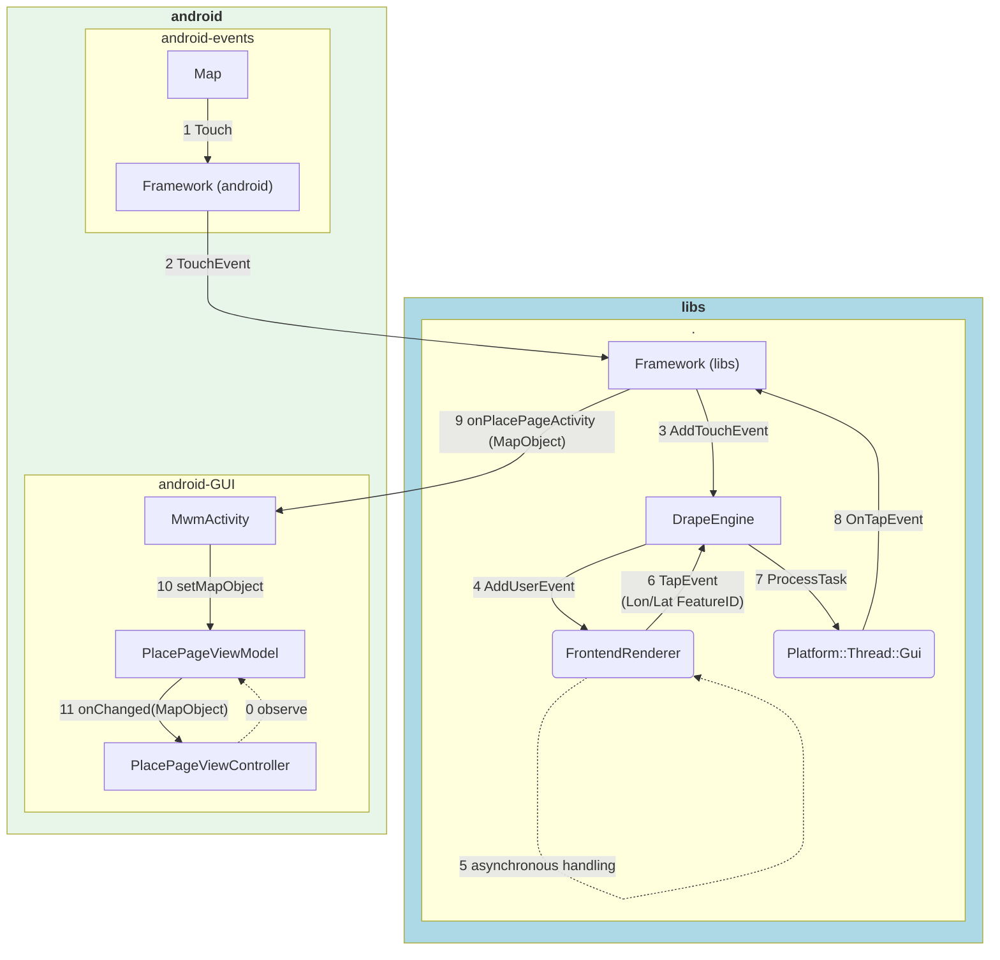

This is a documentation from a beginner for other beginners.

Its main goal is to explain the full chain on Android, of how clicking a point on the map will open a PlacePage dialog which shows information about the map POI on which you have clicked. **And especially help to understand how a screen X,Y coordinate is transformed into a detailed object from the map.**

But this reveals many core mechanisms.

The target environment is Android, but you can extrapolate to what happens for Desktop and Iphone platforms.

**Notes:**

- This document contains text which looks like java/c++ code fragments. This is just for illustration. There is no commitment to be valid java/C++ code !
- In some cases, when it reveals important information, function arguments are provided. But not always.

# Basic Principles

### Platform independent layer

A lot of c++ core code is under `libs`. 

Android code is essentially java, with some parts of C++ . It can call `libs` code, or be called by it.

Some Java code describes JNI (Java Native Interface) stuff which makes the bridge between C++ and Java

`libs/platform` contains an abstraction layer for the different platforms offering many services like

- Get all the files in a directory
- Ask a different Thread to execute a method in a class
- ...

There is an implementation file for each platform `platform_android.cpp` , `platform_qt.cpp`, `platform_ios.mm` ...

### Inter-Threads communication

CoMaps app runs several threads in parallel. So there is a mechanism so that a Thread asks another one to execute the method of a class.

Different implementations exist ( using network, queues...), based on both home made code, and platform OS capabilities. Tne one used in the context of this document is:

- The sender writes a message (target thread, target method to execute, parameters) to a queue
- The queue is implemented using OS mechanisms
- The receiver must have implemented a loop which reads the queue, interpret message, and call the appropriate method

As an example, the thread which detects that the User has clicked on the map, will use a piece of code `GetPlatform().RunTask( remote thread task to execute )` , so that the thread managing UserInterface can cause the opening of the PlacePage dialog.

- `GetPlatform()` returns the independent layer
- `RunTask` is one of those generic services

 ### Android SurfaceView  class. Detecting User events

 This Android OS class manages the application display screen, providing features to:

- draw things on the display
- detect user actions, like cliking on the screen

CoMaps encapsulates this class in class `MapView`
```
//android/sdk/src/main/java/app/organicmaps/sdk/MapView.java
public class MapView extends SurfaceView
```

MapView creates a `Map` object, which represents the map. (`android/sdk/src/main/java/app/organicmaps/sdk/Map.java`)

```
  // MapView overrides this Android system method, which Android calls when the user clicks on the screen
  public boolean onTouchEvent(@NonNull MotionEvent event)

	// ... so that it calls   Map.onTouch(action, event, pointerIndex);

  // event is a MotionEvent object , with x,y coordinates that are x,y coordinates on the screen
```

# Low level : Framework and Drape

### Components

Framework has 2 sides: one for Android, one for Libs 

On Android side
- android/sdk/src/main/cpp/app/organicmaps/sdk/Framework.cpp
- android/sdk/src/main/cpp/app/organicmaps/sdk/Framework.java : declares java Framework class , having nativeXXXXXX methods to wrap  Framework.cpp

On Libs side
- libs/map/framework.cpp : The core Framework component


Drape has the responsability to draw map objects on the application screen. It is made of 3 components
- DrapeEngine class : `libs/drape_frontend/drape_engine.cpp` : the main engine
- FrontendRenderer class : `libs/drape_frontend/frontend_renderer.cpp` . It runs in a thread created by DrapeEngine
- BackendRenderer class : `libs/drape_frontend/backend_renderer.cpp` . It runs in a thread created by DrapeEngine

### Setting event listeners

At startup, `Framework::CreateDrapeEngine()` from  `libs/map/framework.cpp` is called to create the DrapeEngine component, and use its `SetTapEventInfoListener` method to define the task to be executed when the Tap event is detected by the system.
After some intermediate steps, the target task is method `onTapEvent` of thread `Platform::Thread::Gui`


# Global picture



- 1,2,3: Touch event is detected and transmitted to Framework, then to DrapeEngine
- 5,6: DrapeEngine forwards to its FrontendRenderer, which processes it asynchronously, and finds out the FeatureID of the map object
- 7,8: Forward back to Framework, through a Platform::Thread::Gui.
- 9: Framework finds out the MapObject information, and transmits to android GUI part
- 10: MwmActivity stores information into PlacePageViewModel
- 11: PlacePageViewController observes changes in the MapObject inside PlacePageViewModel, and launches the PlacePageDialog

# Low level chain : 
### Step1 

Touch event is detected by Android OS, and transmitted Map => Framework => DrapeEngine => FrontendRenderer => enqueued in the FrontendRenderer's  UserEventStream

This allows the event to be processed asynchronously

- Android OS detects that User has clicked on the screen ( Touch event )
- MapView::onTouchEvent(...)  `android/sdk/src/main/java/app/organicmaps/sdk/Map.java` ( overrideswrites SurfaceView::onTouchEvent )
- Map.onTouch(...) `android/sdk/src/main/cpp/app/organicmaps/sdk/Map.cpp`
- Map.nativeOnTouch(...)
- Framework::Touch(...)   `android/sdk/src/main/cpp/app/organicmaps/sdk/Framework.cpp`
- // switch inside libs core layer
- Framework::TouchEvent(...)  `libs/map/framework.cpp`
- DrapeEngine::AddTouchEvent(...) `libs/drape_frontend/drape_engine.cpp`
- DrapeEngine::AddUserEvent(...)
- FrontendRenderer::AddUserEvent(...) `libs/drape_frontend/frontend_renderer.cpp`
- // FrontendRenderer has an internal UserEventStream queue for user events
- UserEventStream::AddEvent(...) `libs/drape_frontend/user_event_stream.cpp`
- emplace_back(event);

### Step2

FrontendRenderer thread has a loop to analyse what is inside its UserEventStream queue

- Will detect the Touch event ( that he has sent to himself ! )
- Enrich the Touch event
- Send to the appropriate handler (Platform::Thread::Gui)

The chain:
- FrontendRenderer::Routine::Do(...)  `libs/drape_frontend/frontend_renderer.cpp`
- FrontendRenderer.IterateRenderLoop(...)
- FrontendRenderer::RenderFrame(...)
- FrontendRenderer::ProcessEvents(...)
- UserEventStream::ProcessEvents(...)   `libs/drape_frontend/user_event_stream.cpp`   // detect that it is a Touch event
- UserEventStream::ProcessTouch( ...) 
- UserEventStream::DetectShortTap(...)
- m_listener->OnTap(...)  // assign the event ot the approprîate listener
- FrontendRenderer::OnTap(...)  // convert x,y position to Mercator Lat/Lon , Find underlying map featureId , transmit 
- DrapeEngine::TapEvent( tapInfo ) `libs/drape_frontend/drape_engine.cpp` // sends the TapInfo to the listener defined by `SetTapEventInfoListener()`
- GetPlatform().RunTask(  target thread = Platform::Thread::Gui , target method = OnTapEvent(place_page::BuildInfo(tapInfo))  )

FrontendRenderer::OnTap() does the transformation to a TapInfo structure
- Compute Mercator lat/lon coordinates, using ScreenBase::PtoG
- Define a search rectangle whose size is defined by `VisualParams::Instance().GetTouchRectRadius()`
- **Find the underlying map object** ( defined by its featureId) , using `GetVisiblePOI(selectRect)`


# GUI UserInterface chain

### Getting information for PlacePage

The target task is analyzed. The final target will be identified to be `Framework::OnTapEvent()`
- UiThread::forwardToMainThread( taskPointer )  `android/sdk/src/main/java/app/organicmaps/sdk/util/concurrency/UiThread.java`
- UiThread::nativeProcessTask( taskPointer )
- android::GuiThread::ProcessTask( taskPointer) `android/sdk/src/main/cpp/app/organicmaps/sdk/util/UiThread.cpp`
- // The target task is analyzed here
- GuiThread::ProcessTask( task )  `android/sdk/src/main/cpp/app/organicmaps/sdk/platform/GuiThread.cpp`
- Framework::OnTapEvent(place_page::BuildInfo const & buildInfo)  `libs/map/framework.cpp`

Inside Framework::OnTabEvent, a PlacePageInfo is built 
- `placePageInfo = Framework::BuildPlacePageInfo(buildInfo)`

It contains all the information usefull for the PlacePage dialog
- title, subtitle, wiki description ...
- a full osm::MapObject , with the list of all the FeatureTypeID associated to the mapobject

The chain for filling the mapobject contains calls to
- Framework::FillFeatureInfo  `libs/map/framework.cpp`
- Framework::FillInfoFromFeatureType
- Info::SetFromFeatureType   `libs/map/place_page_info.cpp`
- MapObject::SetFromFeatureType `libs/indexer/map_object.cpp`

### Launch PlacePage dialog

Finally, Framework::OnTapEvent calls Framework::ActivateMapSelection
- Tell DrapeEngine to draw a selection circle
- Calls a callback ( previously defined by Framework::SetPlacePageListeners, so that MwmActivity::onPlacePageActivated is run to open the PlacePage dialog )

MwmActivity::onPlacePageActivated `android/app/src/main/java/app/organicmaps/MwmActivity.java`
- PlacePageViewModel::setMapObject( mapObject ) `android/app/src/main/java/app/organicmaps/widget/placepage/PlacePageViewModel.java`
 
PlacePageViewModel contains an element mMapObject which is a **MutableLiveData** object. This means a data associated with an observer. 
Each time we do mMapObject.setValue(mapobject), the observer will be notified.

PlacePageViewController is the controller which pilots the display of PlacePage dialog.
At creation, its `onStart()`method asks to observe the  MutableLiveData object from PlacePageViewModel 
`mViewModel.getMapObject().observe(requireActivity(), this)`

When mMapObject changes inside PlacePageViewModel, PlacePageViewController is notified with a call to `PlacePageViewController::onChanged(MapObject mapObject)`

Populating the PlacePage dialog is done by class `android/app/src/main/java/app/organicmaps/widget/placepage/PlacePageViewModel.java`


